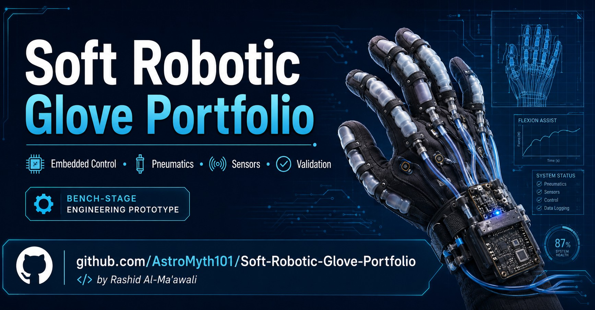

# Soft Robotic Glove Portfolio



Public engineering portfolio for a **soft robotic glove controller** developed at **Sultan Qaboos University (SQU)**.

This repository documents the control architecture, wiring, firmware variants, bench validation, and analysis tools.

> **Status:** Bench-validation engineering prototype  
> **Human testing:** NOT APPROVED — this is an engineering research prototype, not a medical device  
> **Primary focus:** Embedded control, electropneumatic actuation, sensor feedback, and engineering documentation

---

## What this project does

The controller drives a five-finger soft pneumatic glove using:

- flex-sensor feedback for finger angle estimation
- a shared pressure/vacuum pneumatic path
- a central 3/2 pressure-vacuum selector valve
- five normally-open 2/2 finger isolation valves
- pressure and vacuum pumps driven through motor-driver hardware
- serial telemetry and LCD feedback in the minimal bench branch
- a structured ESP32-S3 firmware line with FSM + PI control, latched faults, SD logging, and a Wi-Fi dashboard

The core engineering loop is:

```text
target angle -> flex sensor feedback -> control command -> pneumatic actuation -> measured angle
```

---

## Firmware lines at a glance

| Line | Board | Identity | Control | Status |
|---|---|---|---|---|
| Bench-validated baseline | Arduino Mega 2560 | `VAA0.0.5.2_Mega2560_SimpleRefined` | Proportional-only, average angle | **Bench-validated (L1–L3)** |
| Full controller | ESP32-S3 | `V008.7.1` | 7-state FSM + PI, latched faults | Development / reference |
| Simplified | ESP32-S3 | `VAA0.0.4.4` | Proportional-only | Bench branch |
| Legacy | ESP32-S3 | legacy proportional line | Worst-unfinished-finger | Superseded |

Full comparison: [`docs/FIRMWARE_LINES.md`](docs/FIRMWARE_LINES.md) · ESP32-S3 architecture: [`docs/ESP32S3_CONTROLLER_OVERVIEW.md`](docs/ESP32S3_CONTROLLER_OVERVIEW.md)

---

## Analysis tools

The `tools/` directory contains CSV validation, step-response analysis, and a control-law simulator. The committed sample logs contain dummy data and do not establish hardware performance:

```text
# check a captured log against the firmware's 25-column CSV contract
python tools/validate_csv_schema.py samples/sample_serial_log.csv

# per-finger step-response metrics (SSE, rise time, overshoot, settling)
python tools/analyze_flex_response.py samples/sample_serial_log.csv

# five-finger control-law simulator (needs numpy; GUI needs matplotlib)
python tools/soft_robotics_hand_sim.py --selftest
```

The validator and analyzer are standard-library-only. Details in [`tools/README.md`](tools/README.md).

---

## Repository map

| Path | Purpose |
|---|---|
| [`docs/PROJECT_BRIEF.md`](docs/PROJECT_BRIEF.md) | High-level problem, scope, requirements, and contribution summary |
| [`docs/ARCHITECTURE.md`](docs/ARCHITECTURE.md) | System modules, pneumatic architecture, valve truth table, data/control flow |
| [`docs/FIRMWARE_LINES.md`](docs/FIRMWARE_LINES.md) | Comparison of all firmware lines and version naming |
| [`docs/ESP32S3_CONTROLLER_OVERVIEW.md`](docs/ESP32S3_CONTROLLER_OVERVIEW.md) | Full controller: FSM state diagram, PI control, fault model, safety layers, telemetry |
| [`docs/CONTROL_STRATEGY.md`](docs/CONTROL_STRATEGY.md) | Proportional control concept and shared-air pneumatic limitations |
| [`docs/SAFETY_AND_VALIDATION.md`](docs/SAFETY_AND_VALIDATION.md) | Safety boundaries, validation levels, and bring-up sequence |
| [`docs/BENCH_VALIDATION_SUMMARY.md`](docs/BENCH_VALIDATION_SUMMARY.md) | What was and was not validated on the bench |
| [`docs/VALIDATION_CHECKLIST.md`](docs/VALIDATION_CHECKLIST.md) | Bench checklist derived from the current controller firmware |
| [`docs/CALIBRATION_WORKSHEET.md`](docs/CALIBRATION_WORKSHEET.md) | Flex-sensor calibration worksheet for the Mega 2560 branch |
| [`docs/PIN_MAP_MEGA2560.md`](docs/PIN_MAP_MEGA2560.md) | Public wiring summary for the minimal Arduino Mega 2560 branch |
| [`firmware_snippets/control_loop_excerpt.cpp`](firmware_snippets/control_loop_excerpt.cpp) | Public-safe excerpt of the proportional control loop |
| [`firmware_snippets/esp32s3_state_machine_excerpt.cpp`](firmware_snippets/esp32s3_state_machine_excerpt.cpp) | Public-safe excerpt of the ESP32-S3 FSM, fault latch, and safety guards |
| [`samples/sample_serial_log.csv`](samples/sample_serial_log.csv) | Representative serial CSV sample, Mega 25-column schema (dummy data) |
| [`samples/sample_esp32s3_session_log.csv`](samples/sample_esp32s3_session_log.csv) | Representative session log, ESP32-S3 20-column schema (dummy data) |
| [`tools/`](tools/) | Runnable CSV validator, step-response analyzer, and control-law simulator |
| [`docs/LIMITATIONS_AND_FUTURE_WORK.md`](docs/LIMITATIONS_AND_FUTURE_WORK.md) | Known limitations and planned engineering upgrades |
| [`docs/PRIVATE_REPO_POLICY.md`](docs/PRIVATE_REPO_POLICY.md) | What is intentionally not included here and why |
| [`CHANGELOG.md`](CHANGELOG.md) | Public portfolio change history |

---

## Current public baseline

The bench-validation claims in this portfolio refer to the **minimal proportional bench controller** line:

```text
Firmware VAA0.0.5.2_Mega2560_SimpleRefined
Controller: Arduino Mega 2560
Control: proportional-only, average-angle feedback
Telemetry: USB Serial CSV + 16x2 I2C LCD + optional MPU6050
```

The Mega baseline uses a proportional control loop without the ESP32-S3 line's additional features.

Validation snapshot (details in [`docs/BENCH_VALIDATION_SUMMARY.md`](docs/BENCH_VALIDATION_SUMMARY.md)):

| Level | Meaning | Status |
|---|---|---|
| L1 | Compile / static review | Completed |
| L2 | Bench electronics | Demonstrated |
| L3 | Pneumatic bench | Demonstrated |
| L4 | Integrated bench reliability | Not fully validated |
| L5 | Human testing | **NOT APPROVED** |

---

## Pneumatic constraints

The current pneumatic hardware uses a shared pressure/vacuum source. That means the system can:

- inflate connected fingers together
- vacuum connected fingers together
- isolate individual fingers after they reach target
- continue moving unfinished fingers while completed fingers are closed off

It cannot:

- inflate one finger while vacuuming another
- regulate independent pressure for each finger
- estimate force from flex sensors alone

These constraints follow from the shared pneumatic circuit and cannot be removed through firmware changes alone.

---

## Engineering scope

- Arduino Mega 2560 and ESP32-S3 firmware: sensor acquisition, proportional/PI control, state machines, and fault handling
- Pump drivers, pneumatic valve sequencing, and flex-sensor calibration
- Serial telemetry, CSV validation, step-response analysis, and control-law simulation in Python
- Wiring documentation and bench-validation procedures

---

## Author

**Rashid Al-Ma'awali**  
Mechatronics Engineering Student, Sultan Qaboos University  
GitHub: [AstroMyth101](https://github.com/AstroMyth101)
