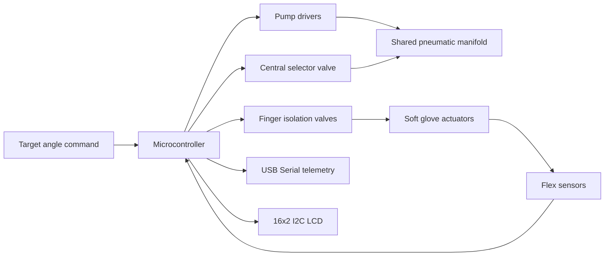
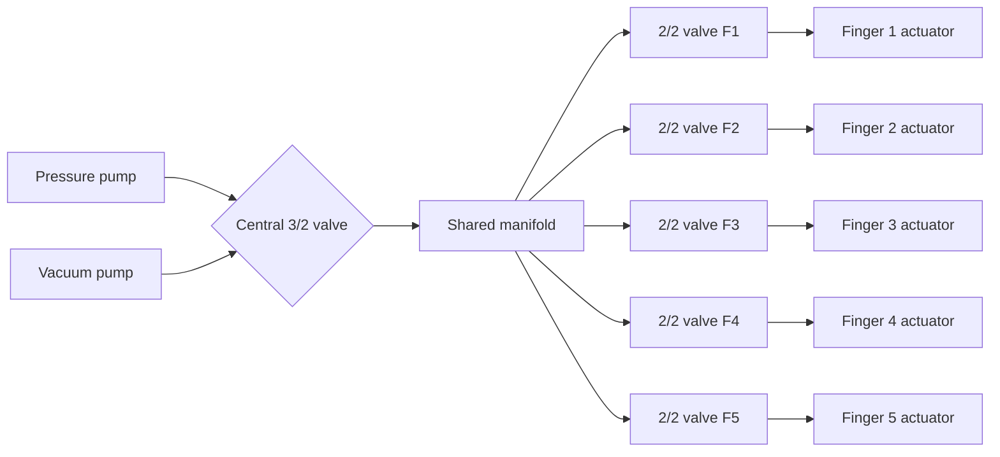

# Architecture

## High-level system



---

## Hardware modules

| Module | Role |
|---|---|
| Microcontroller | Reads sensors, computes control command, drives outputs |
| Flex sensors | Estimate finger bending angle |
| Pump drivers | Drive pressure and vacuum pump channels |
| Central selector valve | Selects pressure or vacuum path for the shared manifold |
| Finger valves | Open or isolate each finger channel |
| LCD | Local status display |
| USB Serial | Commands, CSV telemetry, debugging |
| Optional IMU | Extra motion data when connected |

---

## Pneumatic architecture

One shared pressure path and one shared vacuum path serve all five fingers.
The central 3/2 valve selects which source feeds the shared manifold; each
finger has a normally-open 2/2 isolation valve between the manifold and its
actuator.



### Valve truth table

| Valve | Command LOW / OFF | Command HIGH / ON |
|---|---|---|
| Central 3/2 selector | Vacuum / opening path | Pressure / flexion path |
| Finger 2/2 (normally open) | Open flow | Closed / isolated |

Two consequences follow directly from this hardware:

1. De-energizing selects the vacuum path and opens the finger isolation valves.
   Actual pressure relief must be verified on the assembled pneumatic circuit.
2. The controller can isolate fingers that reached their target, but it cannot
   inflate one finger while vacuuming another or regulate per-finger pressure.

---

## Minimal controller data flow

```text
1. Read five flex sensors.
2. Convert each raw reading into an angle estimate.
3. Compute the average glove angle.
4. Compare average angle with target angle.
5. Apply proportional control.
6. Select pressure, vacuum, or hold mode.
7. Update pump PWM and valve states.
8. Stream telemetry.
```

---

## Firmware style

The Mega 2560 baseline excludes:

- no Wi-Fi
- no WebSocket dashboard
- no SD card logging
- no FreeRTOS task split
- no PID or PI loop
- no large fault framework

The ESP32-S3 line adds a scheduler, state machine, fault handling, logging, and a dashboard. See [`ESP32S3_CONTROLLER_OVERVIEW.md`](ESP32S3_CONTROLLER_OVERVIEW.md).

