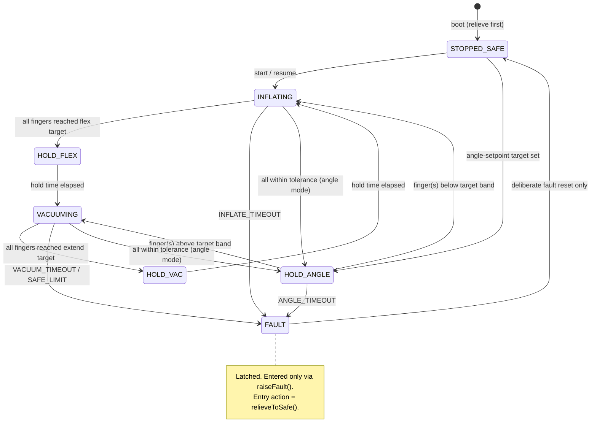

# ESP32-S3 Controller Overview

Source reference: full controller line, firmware `V008.7.1`
Board reference: ESP32-S3-WROOM-2-N32R16V (Waveshare ESP32-S3 dev kit)
Status: development / reference line (the bench-validated baseline is the Mega 2560 branch)

This document describes the architecture of the full research controller. A
public-safe code excerpt is available at
[`firmware_snippets/esp32s3_state_machine_excerpt.cpp`](../firmware_snippets/esp32s3_state_machine_excerpt.cpp),
and a representative dummy session log at
[`samples/sample_esp32s3_session_log.csv`](../samples/sample_esp32s3_session_log.csv).

---

## Firmware structure

The firmware runs a deterministic cooperative scheduler (no FreeRTOS task
split, no blocking delays in the control path):

| Task | Period | Role |
|---|---:|---|
| Sensors | 20 ms | Read 5 flex channels (7 samples, drop min/max), safety guards |
| Control | 20 ms | FSM tick + PI control |
| Logging | 20 ms | CSV row to microSD and/or USB serial |
| WebSocket | 50 ms | Dashboard telemetry broadcast |
| Serial telemetry | 100 ms | Human-readable status lines |
| LCD | 200 ms | 16x2 I2C status display |

Two orthogonal layers select behavior:

- **Operation mode** — `MODE_ANGLE_SETPOINT` (track one common target angle) or
  `MODE_THERAPY_CYCLE` (timed flex/extend cycling). Boot default is angle mode,
  stopped, with no target set.
- **FSM state** — which phase of motion the controller is in (below).

---

## State machine



States: `INFLATING`, `HOLD_FLEX`, `VACUUMING`, `HOLD_VAC`, `HOLD_ANGLE`,
`STOPPED_SAFE`, `FAULT`.

- Every state transition begins with an immediate (un-slewed) pump stop.
- `HOLD_ANGLE` is the within-tolerance hold for angle-setpoint mode: pumps off,
  valve parked on the lower-energy vacuum side, finger valves isolated.
- `STOPPED_SAFE` is the explicit stopped/relieved label: pumps off, vacuum/relief
  path, all finger valves open — no finger stays pressurized.
- Intensity profiles (`Slow` / `Medium` / `Fast`) scale hold times and PWM bands.

---

## Control law

Per-direction **PI control with anti-windup** replaces the minimal branch's
proportional-only law:

- Separate pressure and vacuum PI gain sets; derivative term present but zeroed.
- Error input is the **worst unfinished finger** (shared pneumatic source: the
  slowest finger defines the demand).
- Deadband around the target suppresses hunting; the per-finger isolation
  cut-off is aligned with the same deadband so a finger plateauing inside the
  band cannot stall the cycle.
- Integral is clamped (anti-windup) and reset on state entry.
- Pump commands pass through a slew limiter (no step changes to the drivers).
- Angle-setpoint mode picks inflate vs vacuum from the worst absolute error and
  holds the direction "sticky" so pumps are not flipped every tick.

---

## Safety architecture

The safety model is layered and fault-latching. A fault is never silent and
never self-clearing.

| Layer | Mechanism |
|---|---|
| Over-flex guard | Hard raw-count limit on every sensor read → `SAFE_LIMIT` fault |
| Bounded recovery | After a `SAFE_LIMIT` reset, the re-check is suppressed only while actively vacuuming and only inside a bounded time window, so a relieving cycle can pull the finger back without an instant re-latch — and a genuinely stuck finger still re-faults |
| Sensor plausibility | Range check per channel; consecutive invalid reads → `SENSOR` fault |
| Sensor filtering | 7 samples per read, min and max dropped |
| Phase timeouts | `INFLATE_TIMEOUT`, `VACUUM_TIMEOUT`, plus an overall `ANGLE_TIMEOUT` watchdog across direction switches in angle mode |
| Fault latch | `raiseFault()` relieves to safe, latches the reason string, and always prints a fault trace regardless of logging configuration |
| Safe relief state | `relieveToSafe()`: pumps off, central valve to vacuum/relief, all finger valves open — never trap a flexed hand |
| Boot ordering | Outputs are driven to the relieved state before any peripheral (LCD/SD/Wi-Fi) initializes |
| MCU supervision | Task watchdog (panic reset) and brownout detector enabled |

Fault reasons: `INFLATE_TIMEOUT`, `VACUUM_TIMEOUT`, `ANGLE_TIMEOUT`,
`SAFE_LIMIT`, `SENSOR`. Recovery requires a deliberate operator fault-reset;
resume attempts during a latched fault are logged and blocked.

---

## Telemetry

CSV session logging to microSD (per-session files) and/or USB serial, sharing
one 20-column schema:

```text
timestamp_ms,event_type,event_value,flex1_raw,flex1_deg,flex2_raw,flex2_deg,
flex3_raw,flex3_deg,flex4_raw,flex4_deg,flex5_raw,flex5_deg,state,intensity,
pressure_pwm,vacuum_pwm,valve_pos,fault_reason,session_stopped
```

- `event_type` distinguishes periodic `DATA` rows from `BUTTON` / `REMOTE` /
  `FAULT` / `SERIAL` / `INFO` event rows, so operator actions and faults are
  reconstructable from the log alone.
- `state` and `fault_reason` are logged as strings (never bare enum numbers),
  which keeps logs readable and robust against enum reordering.
- See [`samples/sample_esp32s3_session_log.csv`](../samples/sample_esp32s3_session_log.csv)
  for a representative dummy session (inflate → hold → vacuum → hold → stop).

Additional interfaces:

- **USB serial CLI** (~40 commands): run control (`go`/`stop`/`reset`), mode and
  intensity selection, per-degree angle targets, logging routing
  (USB/SD/both/quiet), diagnostics, and NVS-persisted runtime settings.
- **Wi-Fi dashboard**: the controller serves a self-contained live dashboard
  over a local access point with WebSocket telemetry. (Network credentials are
  bench-configured and not part of the public documentation.)
- **16x2 I2C LCD** for at-a-glance state, angles, and fault reason.

---

## Relationship to the public baseline

| Aspect | Mega 2560 baseline (`VAA0.0.5.2`) | ESP32-S3 line (`V008.7.1`) |
|---|---|---|
| Control | Proportional-only, average angle | PI per direction, worst unfinished finger |
| Structure | Single loop | Cooperative scheduler + FSM |
| Faults | Safe-stop only (intentional) | Latched fault model, 5 fault reasons |
| Logging | USB serial CSV (25 columns) | microSD + serial CSV (20 columns), event rows |
| Interfaces | Serial CLI + LCD | Serial CLI + LCD + Wi-Fi dashboard |
| Validation | Bench-validated (L1–L3) | Development / reference |

The ESP32-S3 development line adds the scheduler, fault model, session logging, and network interfaces. Its validation status is separate from the Mega baseline. See [`FIRMWARE_LINES.md`](FIRMWARE_LINES.md) for the full comparison.
